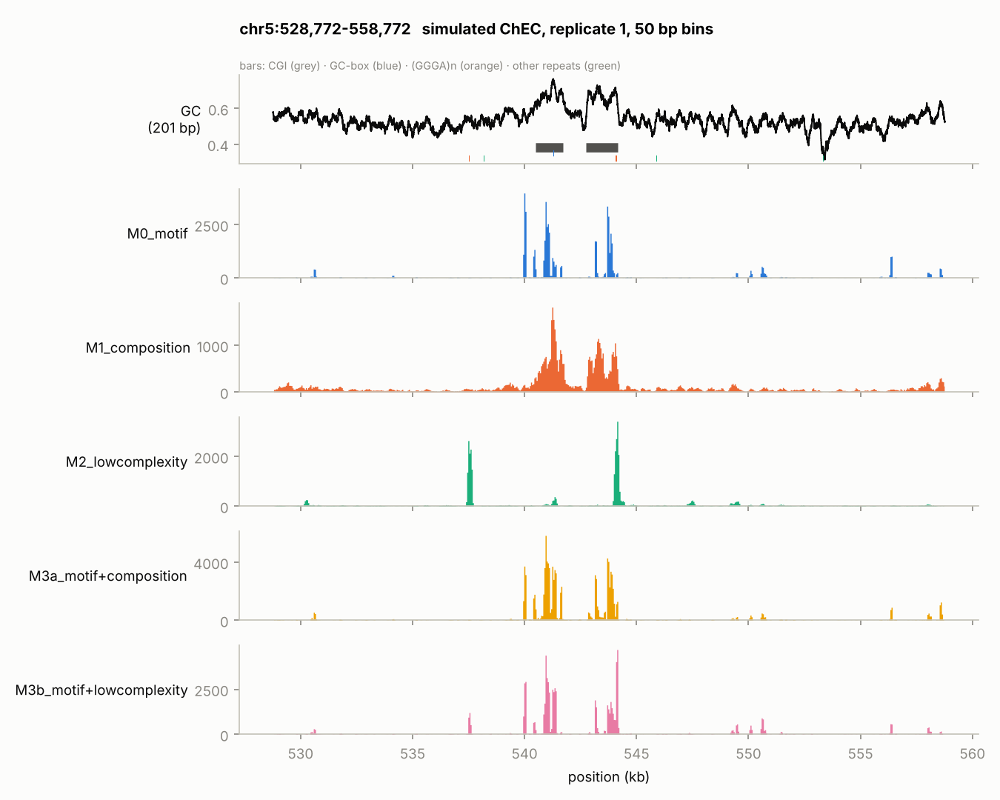
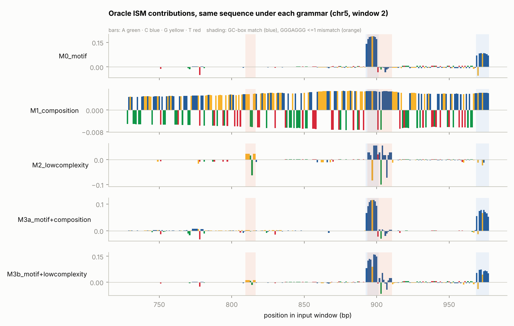
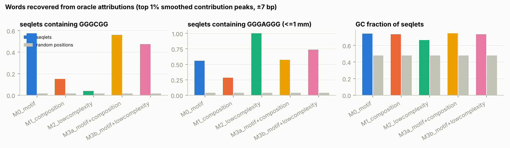
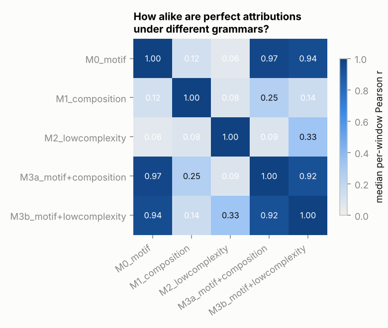
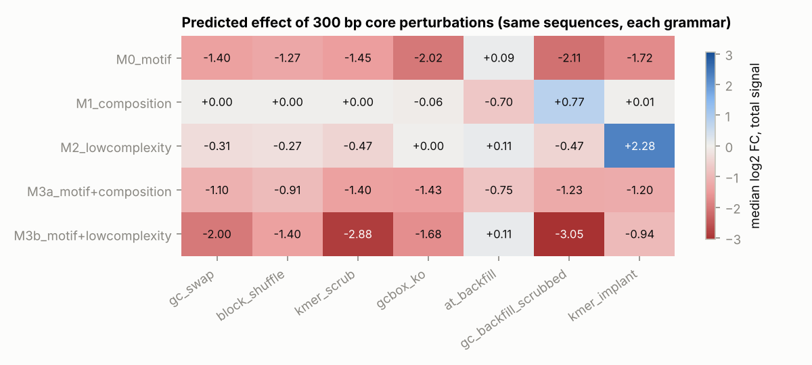

# spidr v0 results

ISM windows: 100 shared windows on the test chromosome (top windows per grammar + random). Mutated region [377, 1737]; analyses scored on the 1000 bp output window.

## Grammars

| grammar | components | mu | k_sat | radius (bp) |
|---|---|---|---|---|
| M0_motif | type=pwm, consensus=GGGGCGGGG, scale=1.5 | -12.87 | 12 | 82 |
| M1_composition | type=composition, window=201, beta=20.0, gc_ref=0.42 | -11.39 | 51.8 | 173 |
| M2_lowcomplexity | type=kmer_avidity, motifs=['GGGAGGG'], max_mm=1, eps_site=2.0, lam=2.0, window=201, beta=1.5 | -11.00 | 16.6 | 180 |
| M3a_motif+composition | type=pwm, consensus=GGGGCGGGG, scale=1.2, name=dbd; type=composition, window=201, beta=12.0, gc_ref=0.42 | -12.55 | 14.9 | 173 |
| M3b_motif+lowcomplexity | type=pwm, consensus=GGGGCGGGG, scale=1.2, name=dbd; type=kmer_avidity, motifs=['GGGAGGG'], max_mm=1, eps_site=2.0, lam=2.0, window=201, beta=1.0 | -12.03 | 14.3 | 180 |

## Training sets: does the sampling regime hide composition?

Spearman rho between input-window GC and log total signal, per split.

| grammar | mode | train n | train rho | test n | test rho |
|---|---|---|---|---|---|
| M0_motif | tile | 11988 | +0.67 | 1998 | +0.69 |
| M0_motif | peaks_gcmatched | 2268 | +0.24 | 388 | +0.20 |
| M1_composition | tile | 11988 | +0.98 | 1998 | +0.98 |
| M1_composition | peaks_gcmatched | 1468 | +0.83 | 261 | +0.75 |
| M2_lowcomplexity | tile | 11988 | +0.62 | 1998 | +0.60 |
| M2_lowcomplexity | peaks_gcmatched | 2376 | +0.19 | 400 | +0.22 |
| M3a_motif+composition | tile | 11988 | +0.82 | 1998 | +0.84 |
| M3a_motif+composition | peaks_gcmatched | 1964 | +0.44 | 353 | +0.30 |
| M3b_motif+lowcomplexity | tile | 11988 | +0.70 | 1998 | +0.72 |
| M3b_motif+lowcomplexity | peaks_gcmatched | 2212 | +0.27 | 383 | +0.22 |

## Oracle attributions

Concentration = share of |contribution| in the top 5% of positions (motif-like = high).

| grammar | concentration | contrib at G/C | contrib at A/T | seqlets | GGGCGG in seqlets (bg) | GGGAGGG<=1mm in seqlets (bg) | top 6-mers (log2 enr) |
|---|---|---|---|---|---|---|---|
| M0_motif | 0.87 | +0.0117 | -0.0090 | 115 | 0.57 (0.02) | 0.56 (0.04) | CCCGCC (3.6), CCCCGC (3.5), CGCCCC (3.5), CGGGGA (3.3), CCGCCC (3.2) |
| M1_composition | 0.09 | +0.0087 | -0.0087 | 224 | 0.15 (0.02) | 0.28 (0.04) | CCGACG (4.1), CGCCAG (3.3), CCGCCG (3.2), GCGGCC (3.1), GCCGGC (3.1) |
| M2_lowcomplexity | 0.82 | +0.0036 | -0.0015 | 156 | 0.04 (0.02) | 1.00 (0.04) | CCCTCC (4.3), CCTCCC (4.0), GAGGGA (3.7), AGGGAG (3.6), CTCCCA (3.0) |
| M3a_motif+composition | 0.64 | +0.0157 | -0.0111 | 121 | 0.56 (0.02) | 0.57 (0.04) | CCCGCC (3.6), CCCCGC (3.5), CGCCCC (3.5), CGGGGA (3.3), CCGCCC (3.3) |
| M3b_motif+lowcomplexity | 0.83 | +0.0135 | -0.0070 | 126 | 0.48 (0.02) | 0.74 (0.04) | CCCGCC (3.5), CGCCCC (3.3), CCCCGC (3.3), CGGGGA (3.2), CCGCCC (3.1) |

## Identifiability: oracle-vs-oracle attribution agreement

| | M0_motif | M1_composition | M2_lowcomplexity | M3a_motif+composition | M3b_motif+lowcomplexity |
|---|---|---|---|---|---|
| M0_motif | 1.00 | 0.12 | 0.06 | 0.97 | 0.94 |
| M1_composition | 0.12 | 1.00 | 0.08 | 0.25 | 0.14 |
| M2_lowcomplexity | 0.06 | 0.08 | 1.00 | 0.09 | 0.33 |
| M3a_motif+composition | 0.97 | 0.25 | 0.09 | 1.00 | 0.92 |
| M3b_motif+lowcomplexity | 0.94 | 0.14 | 0.33 | 0.92 | 1.00 |

## Design discrimination (median log2 FC of total signal)

| | gc_swap | block_shuffle | kmer_scrub | gcbox_ko | at_backfill | gc_backfill_scrubbed | kmer_implant |
|---|---|---|---|---|---|---|---|
| M0_motif | -1.40 | -1.27 | -1.45 | -2.02 | +0.09 | -2.11 | -1.72 |
| M1_composition | +0.00 | +0.00 | +0.00 | -0.06 | -0.70 | +0.77 | +0.01 |
| M2_lowcomplexity | -0.31 | -0.27 | -0.47 | +0.00 | +0.11 | -0.47 | +2.28 |
| M3a_motif+composition | -1.10 | -0.91 | -1.40 | -1.43 | -0.75 | -1.23 | -1.20 |
| M3b_motif+lowcomplexity | -2.00 | -1.40 | -2.88 | -1.68 | +0.11 | -3.05 | -0.94 |

## Figures

